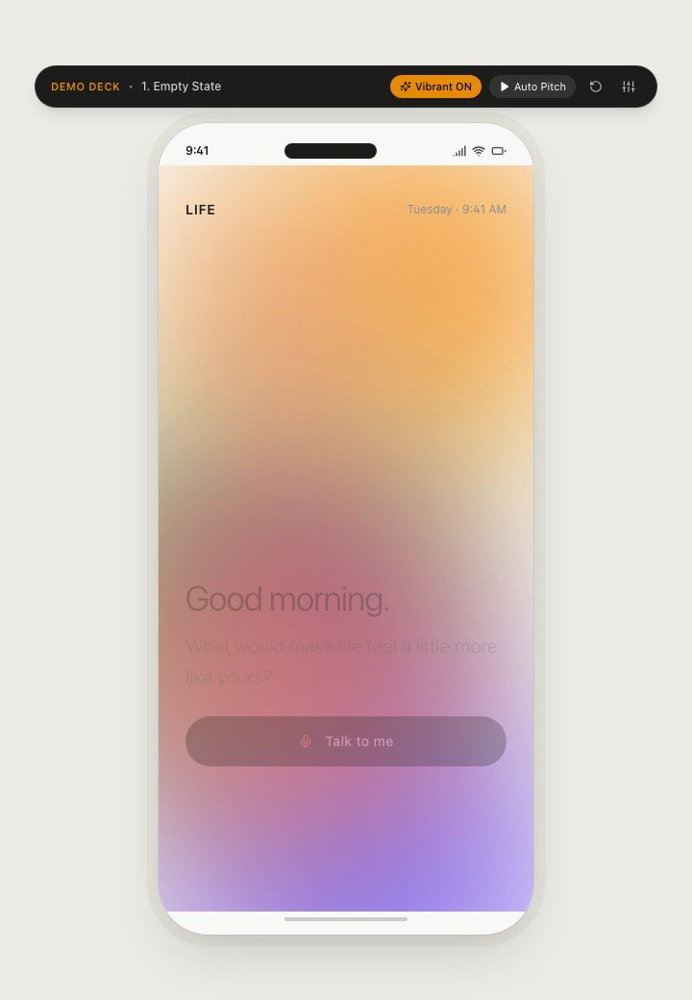

# LIFE: Personal Life Companion

**A phone-app concept that helps people make room for the things they've been meaning to do, and remembers how those moments felt.**


<p align="center"></p>

## The idea

Most productivity apps optimise for getting more done. LIFE starts from a different question: *"What would make life feel a little more like yours?"*

You talk to the companion. It picks up what you've been wanting to try, such as cooking, tennis, photography, pottery or guitar. Then it spots openings in your day and suggests something that fits: *"You have a 50-minute opening. Tennis fits cleanly here."* After each experience, LIFE saves a memory, and the colours of that moment gradually tint the whole interface. The more you live, the more vibrant the app becomes.

## What's in the prototype

- **Four tabs:** Today, Life, Journal and Explore, inside an interactive phone frame.
- **Conversation onboarding:** a simulated voice conversation with "Arjun" that surfaces your aspirations.
- **Activity experiences:** step-by-step modals for cooking, tennis, a golden-hour photo walk, pottery and guitar.
- **Protected time:** the companion can hold a slot in your day, for example a 45-minute tennis session.
- **Memory capture:** each memory stores a quote, an emotion and an extracted colour palette.
- **A living surface:** the background gradient shifts with your memories, mood and a "vibrance" boost.
- **Personalisation:** quiet, social or structured companion styles that change how suggestions are framed, plus a mood check-in (good, okay, low, overwhelmed). Choosing "overwhelmed" calms the surface and offers space to breathe.

## Demo deck

The bar above the phone runs a scripted, 11-step walkthrough for presentations: from an empty state through conversation, cooking, saving a memory, protecting tennis and the photography challenge, to the final full-vibrance state. **Auto Pitch** plays it hands-free, and the controls let you jump to any step, reset, or switch personality and mood live.

## Run locally

```bash
git clone https://github.com/ta1rc/IQOO-.git
cd IQOO-
npm install
npm run dev
```

Open the URL Vite prints (usually http://localhost:5173).

| Command | What it does |
|---|---|
| `npm run dev` | Start the dev server with hot reload |
| `npm run build` | Type-check and build to `dist/` |
| `npm run preview` | Serve the production build |
| `npm run lint` | Type-check only |

## Project structure

```
src/
  App.tsx              tabs and modal layers inside the phone frame
  components/          PhoneFrame, LifeSurface (animated gradient), BottomNavigation, DemoController
  views/               Today, Life, Journal, Explore + activity and memory modals
  store/useLifeStore.ts  Zustand store: demo flow, mood, personality, activities, memories
  types/               shared types (activities, memories, demo steps)
public/assets/         activity photography
```

## Tech stack

React 18 and TypeScript on Vite, styled with Tailwind CSS, animated with Framer Motion, with state in Zustand and icons from Lucide.
